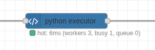

# Python Executor for Node-RED

`@rosepetal/node-red-contrib-python-executor` provides a node that runs Python code on each message, in the way the function node runs JavaScript, and a configuration node that creates the Python virtual environments the code can run in and manages their packages.



## Installation

```bash
cd ~/.node-red
npm install @rosepetal/node-red-contrib-python-executor
```

Or search `@rosepetal/node-red-contrib-python-executor` in the Node-RED Palette Manager.

Use the scoped name: `node-red-contrib-python-executor`, without `@rosepetal/`, is a different package on npm.

These pages describe version 1.1.0. The Palette Manager installs the version registered in the Node-RED library, which is updated separately from npm: check the installed version if something described here is missing.

## Requirements

- Node.js >= 14
- Python 3.6 or later on the machine that runs Node-RED
- The `venv` module of that Python, to create environments from the editor *(on Debian and Ubuntu: `sudo apt install python3-venv`)*
- NumPy in the interpreter that runs the code, for the image helpers `rp_to_cv` and `rp_from_cv` *(optional; OpenCV is used when it is installed, and is not required)*

The package has no npm dependencies and the code it runs in Python uses the standard library only.

The interpreter is, in this order, the one of the [environment](./python-environment.md) selected in the node, or the command written in its **Python Path** field: `python3` by default, looked up in the `PATH` of the Node-RED process.

## Nodes

| Node | Purpose |
|------|---------|
| **[python-executor](./python-executor.md)** | Run Python code on each message: the code receives `msg` as a `dict` and what it returns is merged into the outgoing message |
| **[python-environment](./python-environment.md)** | Configuration node: create a Python virtual environment, install and uninstall its packages with pip from the editor, and make `python-executor` nodes run in it |

`python-executor` appears under the **function** category of the palette, labeled **python executor**. `python-environment` is created from the **Environment** field of a `python-executor` node.

## Quick start

```
[inject] → [python executor] → [debug]
```

1. Drop a **python executor** node into the flow and connect an **inject** node to its input and a **debug** node to its output.
2. Replace the example code the node comes with (it expects an image in `msg.image`) with:

   ```python
   msg['payload'] = f"Hello, {msg.get('payload', 'world')}!"
   return msg
   ```

3. Deploy and press the button of the inject node. The debug sidebar shows `Hello, ` followed by the payload of the message, and the status of the node shows the time the message took, as in `cold: 25ms`.

The code is the body of a function that receives `msg`. Besides `msg` it can use `flow_ctx` and `global_ctx` (flow and global context), `node.warn()` and the two image helpers: see [The code](./python-executor.md#the-code).

## Execution modes

| | Cold mode (default) | Hot mode |
|---|---|---|
| **Process** | A new Python process for every message | A pool of 1 to 10 Python processes that stay alive |
| **Imports** | Loaded again on every message | Loaded once in each worker; **Preload Imports** loads them before the first message |
| **State between messages** | None | Global variables of each worker persist |
| **`Buffer` values** | Arrive as a `dict` with a list of byte values | Arrive as `bytes` |
| **Suited to** | Occasional messages, small data | Frequent messages, heavy libraries, images |

See [Execution modes](./python-executor.md#execution-modes) for what each one does with queues, timeouts and `print()`.

## Images

`rp_to_cv` and `rp_from_cv` convert between the image object that the [`@rosepetal/node-red-contrib-image-tools`](https://docs.rosepetal.ai/flows/node-red-contrib-image-tools) nodes produce (`{data, width, height, channels, colorSpace, dtype}`) and a NumPy array in the channel order OpenCV works in:

```python
import cv2

img = rp_to_cv(msg["payload"])          # BGR ndarray, ready for cv2
img = cv2.GaussianBlur(img, (7, 7), 0)
msg["payload"] = rp_from_cv(img, like=msg["payload"])
return msg
```

See [Images](./python-executor.md#images).

## License

Apache-2.0.

The package is published on npm as [`@rosepetal/node-red-contrib-python-executor`](https://www.npmjs.com/package/@rosepetal/node-red-contrib-python-executor).
